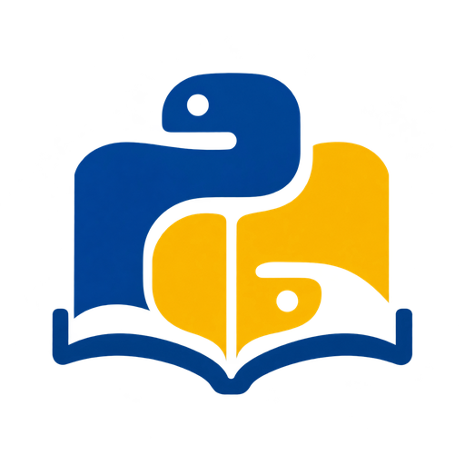

# Pythonizer

<p align="center">
  
</p>

<p align="center">
  A native Python editor for school: write code, run it, and see your classes as a <b>UML class diagram</b>.
</p>

<p align="center">
  <a href="https://github.com/dren413/Pythonizer/releases">Downloads</a>
  ·
  <a href="https://github.com/dren413/Pythonizer/releases/latest">Latest Release</a>
</p>

---

Pythonizer was created from a teacher's perspective to fill a gap in teaching tools.
Version 2 is a native rewrite in Rust. It drops the tkinter GUI designer and adds a live, two-way
UML class diagram. There is no web view, no Node.js, and nothing to install for pupils.

| Class | What they use |
|-------|---------------|
| **2CB** | Code only: editor + console (with `input()` support). Hide the UML panel. |
| **1CB** | Classes and pygame, with a live, two-way UML diagram. |

## Features

- **Editor**: Python highlighting, line numbers, auto-indent after `:`, Tab/Shift+Tab
  (also on several lines), Backspace removes a whole indent level, Ctrl+/ comments lines,
  undo/redo, adjustable font size (good for projectors).
- **Run** (F5) the main file or **run the open file** (Ctrl+F5). **Stop** with Shift+F5.
  Files are saved automatically before running.
- **Console**: output and errors, an **input field for `input()`**, clickable traceback lines.
  The line with the error is shown in red in the editor.
- **UML class diagram (left)**, built live from the code as you type:
  - boxes with three parts: class name / attributes `x: int` / methods `move(p:(int,int))`
  - types come from annotations or are guessed from values (`self.speed = (4, 3)` → `(int,int)`)
  - class attributes are underlined; `extends Sprite` is shown for external base classes
  - arrows for inheritance (between project classes) and associations (`self.balls: list[Ball]`)
  - drag boxes, scroll/pinch to zoom, double-click to open the code, **Export SVG** for worksheets
- **UML → code**: right-click in the diagram to add a **class** (optionally in its own file, with
  the import added to `main.py`), **attributes** (optionally as constructor parameters),
  **methods** with typed parameters and return types, or a **constructor**, or to **delete a method**.
  You can type types in UML style (`(int,int)`); the code gets `tuple[int, int]`.
- **Files (right)**: add, rename and delete files, and choose the main file (▶).
- **Templates**: Script (2CB), Classes (1CB), Pygame (1CB, the Pong exercise 5.19), Empty.
- **Python**: uses the built-in Python (release builds) or finds an installed one.
  *Run ▸ Install pygame* installs pygame into the interpreter in use.
- Light/dark mode and interface zoom (Ctrl +/−).

## Project format

A project is just a folder of `.py` files. `pythonizer.json` remembers the main file and
the UML box positions. Any folder with Python files can be opened. Old tkinter projects
also open; `gui.py` then appears as a normal file.

## Develop

```bash
cargo run                 # debug build, uses an installed Python 3
cargo run -- path/to/project
cargo test                # parser, code generator, editor, console, runner tests
```

## Ready-to-run downloads (no installation for pupils)

The `Build Pythonizer` GitHub workflow (`.github/workflows/build.yml`)
builds:

- `Pythonizer-windows-x64.exe`: a **single portable exe**. Double-click and it runs. No installer
  and no Visual C++ runtime needed.
- `Pythonizer-macos-arm64.dmg` / `Pythonizer-macos-x64.dmg`: the app can be started directly
  from the DMG, or dragged to Applications.

Both have **Python 3.12 + pygame built in**. On first start the built-in Python is unpacked
once (a few seconds) into the user's local app-data folder
(`%LOCALAPPDATA%\Pythonizer` / `~/Library/Application Support/Pythonizer`).
Push a tag like `v2.0.0` to publish a release.

To build one locally:

```bash
python3 packaging/prepare_python.py aarch64-apple-darwin python-runtime.zip   # downloads Python, installs pygame
PYTHONIZER_PYTHON_ZIP="$PWD/python-runtime.zip" cargo build --release --features bundled-python
packaging/macos/make_dmg.sh target/release/pythonizer Pythonizer.dmg         # macOS only
```

Python builds come from [python-build-standalone](https://github.com/astral-sh/python-build-standalone).

**macOS note:** the DMG gets an ad-hoc signature only. On first launch pupils must
right-click ▸ Open (or allow it in System Settings ▸ Privacy & Security). To avoid that, set
`MACOS_SIGN_IDENTITY` to a Developer ID certificate and notarize the DMG.

## Previous version

The earlier Tauri/React version with the visual tkinter designer (v1.x) is kept in
[`old/`](./old/README.md). Its GitHub workflows are in `old/.github/` and are no longer run.
